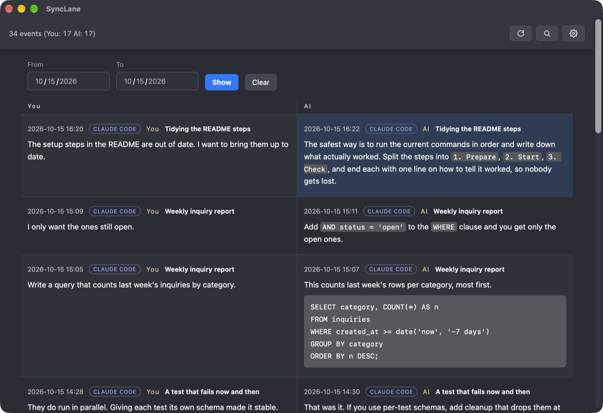
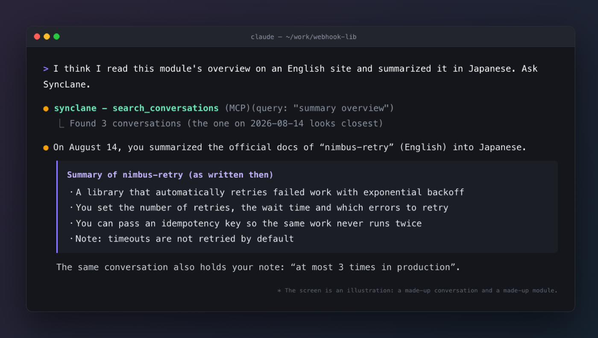

# SyncLane

[日本語](README.md) | English

**Keep every conversation you have with AI, and find it again.**

SyncLane is a free, open-source Mac app that keeps your conversations with Claude Code, Codex, Gemini and ChatGPT in one place on your own computer. Search them by keyword or date, or let your AI search them for you.



*The screen shows made-up conversations.*

- **One place for your AI conversations**: Claude Code and Codex are collected automatically; Gemini and ChatGPT (web) come in through a Chrome extension.
- **Ask your AI about your own past**: it works as an MCP server, so you can ask “How did we solve this before?” (read-only).
- **Your record stays on your Mac**: it is stored in a local SQLite file, and stays even if a tool stops showing its history. **By default nothing is sent anywhere.**
- **Japanese works too**: full-text search, with substring matching for Japanese.
- Free and open source (MIT). Installs from a signed and notarized dmg ([download](https://mrktools.app/en/synclane/download/)).

Only if you connect to a SyncLane server (for example one your company runs) are the conversations you choose sent there (optional; see "Send to a server" below).

## What it imports

| Source | How |
|---|---|
| Claude Code | Automatic every 30 seconds while the app runs (`~/.claude/projects`) |
| Codex (Codex app, Codex CLI) | Automatic every 30 seconds while the app runs (`~/.codex/sessions`) |
| Gemini (web), ChatGPT (web) | Chrome extension ([how](#importing-gemini-and-chatgpt-conversations-chrome-extension)) |
| Gemini CLI | Command (`import gemini`; build from source) |

The command (CLI) is **not included in the download (dmg)**. Build it from the source (see "Development" below). The downloaded app only has the window and the MCP server (`--mcp`) your AI uses to search.

It saves your input and the AI's text replies. Tool output and the AI's reasoning are not saved.

## Install

Download the dmg from [mrktools.app/en/synclane/download/](https://mrktools.app/en/synclane/download/) and put `SyncLane.app` in `/Applications`. It is signed and notarized, and the app tells you when a new version is out.

While the app is running, it imports new Claude Code conversations (`~/.claude/projects`) and new Codex conversations (`~/.codex/sessions`) every 30 seconds.

## Importing Gemini and ChatGPT conversations (Chrome extension)

Conversations on the web versions of Gemini (gemini.google.com) and ChatGPT (chatgpt.com) have no local files, so a Chrome extension imports them.

1. Download and unzip the extension. This makes a `~/Downloads/SyncLane-extension` folder (do not delete it, or the extension stops working).

   ```
   https://mrktools.app/downloads/synclane/SyncLane-extension.zip
   ```

2. Open `chrome://extensions` in Chrome and turn on "Developer mode" (top right).
3. Click "Load unpacked" and choose `~/Downloads/SyncLane-extension`.
4. Keep SyncLane running and open a conversation on Gemini or ChatGPT (reload tabs that were already open before you installed the extension). It is imported automatically once the answer is finished.

- It sends data only to the SyncLane app on this Mac (`127.0.0.1`), never to an external server. If the app is not running, it retries later.
- Only **conversations opened in Chrome** are imported. A conversation held only in the Gemini Mac app or on your phone is not imported, even though it syncs, until you open it once in Chrome.
- For message times, ChatGPT uses the time shown on the page. Gemini shows none, so the time recorded is when it was imported. Text is plain: formatting such as headings and tables is dropped.
- To use it from source, choose the `extension/` folder of this repository. Build the zip with `sh scripts/pack-extension.sh`.
- If a site changes its page layout, importing may stop working. When a conversation page yields nothing, the extension icon shows "!" ("×" when the SyncLane app is not running). See [`extension/README.md`](extension/README.md) (in Japanese) for how to fix it.

## How search works

It has a full-text index, and Japanese works as a substring match. Terms of 3 or more characters use the index; shorter terms scan the text directly. The index makes the database about 40% larger.

## Editing conversation titles

Use the ✎ next to a title in the list to rewrite it. Claude Code gives a conversation a title once, at the start, and never updates it when the topic changes.

- A title applies to **one stretch of the conversation (a "section")**, not the whole thing. In a long conversation, changing the title of one topic does not affect the others. Sections start automatically after a gap of **30 minutes or more**, and where the conversation is continued from a summary (where Claude Code summarised a long conversation and carried on). Save a title empty to remove it and go back to the title of the whole conversation.
- A title you edit is not overwritten by later imports.
- "Suggest from recent messages": proposes a title from your recent messages with local rules. Nothing leaves your Mac.
- What is sent to a server is still the title of the whole conversation (section titles are used only on your Mac).

## Send to a server (optional)

If you connect to a SyncLane server (for example one your company runs), you can send the conversations you choose to it over HTTPS, so your team can search past decisions together. The server is provided separately and is not part of this repository.

- **If you do not connect, nothing is sent.** Even after connecting, **nothing is sent by default**: you pick the conversations, or turn on the automatic mode.
- You connect by approving in your browser (the app never asks for a password). The device token is kept in the macOS keychain.
- What is sent: the text of the conversation (your messages and the AI's replies), the title, the project path and the times. You can exclude any conversation at any time.
- **Anything that looks like a secret is masked before sending.** API keys, tokens, private keys, passwords in URLs and assignments such as `password=…` or `…_key=…` are replaced with `[MASKED:kind]`. Only what is sent is masked; your local record and search are unchanged. It errs on the side of masking, so it may also mask something that is not a secret.
- **You can edit both lists in Settings → "Masking secrets"** (they are stored as files next to the database, which you can also edit directly).
- To send a value as it is, put it on its own line (`mask-allow.txt`; lines starting with `#` are comments). Only an **exact match** is let through, and the value is then sent as written.
- Names that only your organisation knows (host names, customer names, project code names) are not covered by the default rules. To always mask a word, put it on its own line (`mask-block.txt`). A plain line is matched as that exact text (case-sensitive); a line ending in `=` or `:` (such as `tabata_key=`) also masks the value that follows; a line starting with `re:` is a regular expression. Lines that are not valid regular expressions are ignored. If the same value is in `mask-allow.txt`, the block list wins.
- The local SQLite file stays the source of truth. If sending fails, importing and local search keep working. Disconnecting deletes the token (conversations already sent stay on the server).

```sh
synclane server connect https://sync.example.com   # approve in the browser
synclane sync list                                 # conversations and whether they are sent
synclane sync include 12 14 --visibility org       # pick conversations (org = visible to everyone on the server)
synclane sync exclude 13                           # never send this one
synclane sync mode auto                            # send everything except what you excluded
synclane sync                                      # send now (the app sends automatically)
synclane server disconnect
```

## Ask your AI (MCP)

Register it with Claude Code:

```sh
claude mcp add --scope user synclane -- /Applications/SyncLane.app/Contents/MacOS/synclane-app --mcp
```

For the Claude app (desktop), add this to `claude_desktop_config.json` (you can also copy it from the “MCP” tab in Settings):

```json
{ "mcpServers": { "synclane": { "command": "/Applications/SyncLane.app/Contents/MacOS/synclane-app", "args": ["--mcp"] } } }
```

Once registered, just ask your AI to “ask SyncLane”, and it searches your saved conversations to answer.



Once registered, that AI can read all of your saved conversations. Check first that they contain no passwords or sensitive code.

## Development

### Tauri app

A minimal window shows saved events in a day-by-day timeline.

```sh
cargo run --manifest-path src-tauri/Cargo.toml --offline
```

The window reads from the default SQLite file (`~/Library/Application Support/SyncLane/synclane.db`).

### Building on Windows (experimental, untested)

**The author has not run it on Windows.** The download (installer) is for macOS only. The code has Windows branches (for example the save location and opening the browser), but whether it builds and whether the window works has not been checked. If you try it, please tell us what went wrong in [Issues](https://github.com/MR-TABATA/SyncLane/issues).

You need: [Rust](https://rustup.rs) (MSVC toolchain), Visual Studio Build Tools (“Desktop development with C++”) and Git. The window (Tauri) also needs WebView2, which comes with Windows 11.

```powershell
git clone https://github.com/MR-TABATA/SyncLane.git
cd SyncLane

# The command (no window)
cargo build --release
.\target\release\synclane.exe --help

# The window
cargo run --manifest-path src-tauri/Cargo.toml
```

The database is at `%LOCALAPPDATA%\SyncLane\synclane.db`. It reads `%USERPROFILE%\.claude\projects` (Claude Code), `%USERPROFILE%\.codex\sessions` (Codex) and `%USERPROFILE%\.gemini\tmp` (Gemini CLI).

### Tests

```sh
cargo test --offline
```

Plain `cargo test` also works when you are online.

### CLI

The default database location is:

```text
~/Library/Application Support/SyncLane/synclane.db
```

During development you can change it with `--db`.

```sh
cargo run -- init
cargo run -- status
cargo run -- --db /tmp/synclane.db init
cargo run -- --db /tmp/synclane.db status
cargo run -- --db /tmp/synclane.db timeline --limit 20
cargo run -- --db /tmp/synclane.db timeline --date 2026-10-13 --limit 20
cargo run -- import claude --date 2026-10-13
cargo run -- --db /tmp/synclane.db import claude --root ~/.claude/projects --date 2026-10-13
```

You can also set the location with the `SYNCLANE_DB` environment variable.

```sh
SYNCLANE_DB=/tmp/synclane.db cargo run -- status
```

### Importing Claude Code logs

`import claude` reads `~/.claude/projects/**/*.jsonl` and appends your input and the AI's text replies to `sessions` / `events`. Tool results and thinking blocks are not saved at this stage.

```sh
cargo run -- import claude --date YYYY-MM-DD
cargo run -- import claude --all
```

### Importing Gemini CLI logs

`import gemini` reads `~/.gemini/tmp/**/*.jsonl` and appends your input and Gemini's text replies. Gemini CLI's update log can repeat the same message array, so duplicates are dropped by message ID.

```sh
cargo run -- import gemini --date YYYY-MM-DD
cargo run -- import gemini --all
```

Omitting `--date` also targets every event, but use `--all` when you mean to import everything. `--date` and `--all` cannot be combined. Importing is idempotent: running it again on the same log does not duplicate events.

### Importing Codex logs

`import codex` reads `~/.codex/sessions/**/rollout-*.jsonl` (logs of the ChatGPT Codex app and the Codex CLI) and appends your messages (`UserMessage`) and Codex's replies (`AgentMessage`). Reasoning, command runs and file changes are not saved. The project comes from the working folder in the log (`cwd`), and the title from the first message.

```sh
cargo run -- import codex --date YYYY-MM-DD
cargo run -- import codex --all
```

- Codex logs can reach hundreds of MB. The app remembers how far it has read and reads only what was appended.
- Branching or duplicating a conversation copies the original history into a new file. A message is saved once and stays in the original session (the copy holds only the messages after the branch).
- Work run on "This computer" in the app does not appear on the ChatGPT website. Import it from the Codex logs (this folder).

### Checking the timeline

`timeline` prints saved events, newest first. It is an early version meant to settle the display model for the Tauri window.

```sh
cargo run -- --db /tmp/synclane.db timeline --date YYYY-MM-DD --limit 20
```

### Current schema

See [docs/sqlite-schema.md](docs/sqlite-schema.md) for the SQLite design (in Japanese).

The main tables are:

- `sessions`: sessions of AI tools
- `events`: raw events such as your input, AI replies and tool runs
- `journals`: diaries generated by AI
- `analyses`: trend analyses per period
- `tags` / `event_tags`: tags
- `settings`: app settings

Events are append-only; the pair `source_tool` and `source_event_id` prevents duplicates.

## License

MIT ([LICENSE](LICENSE))
