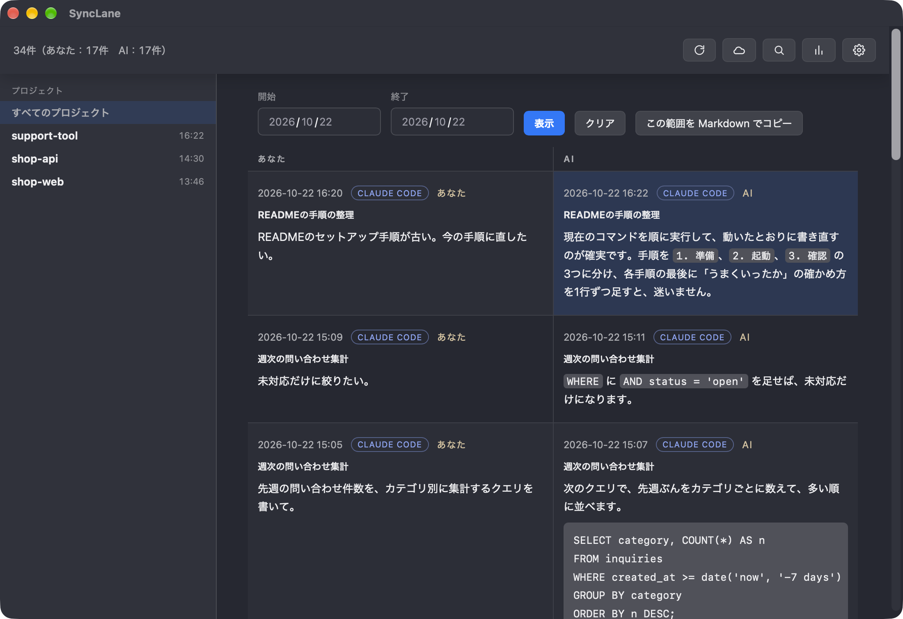
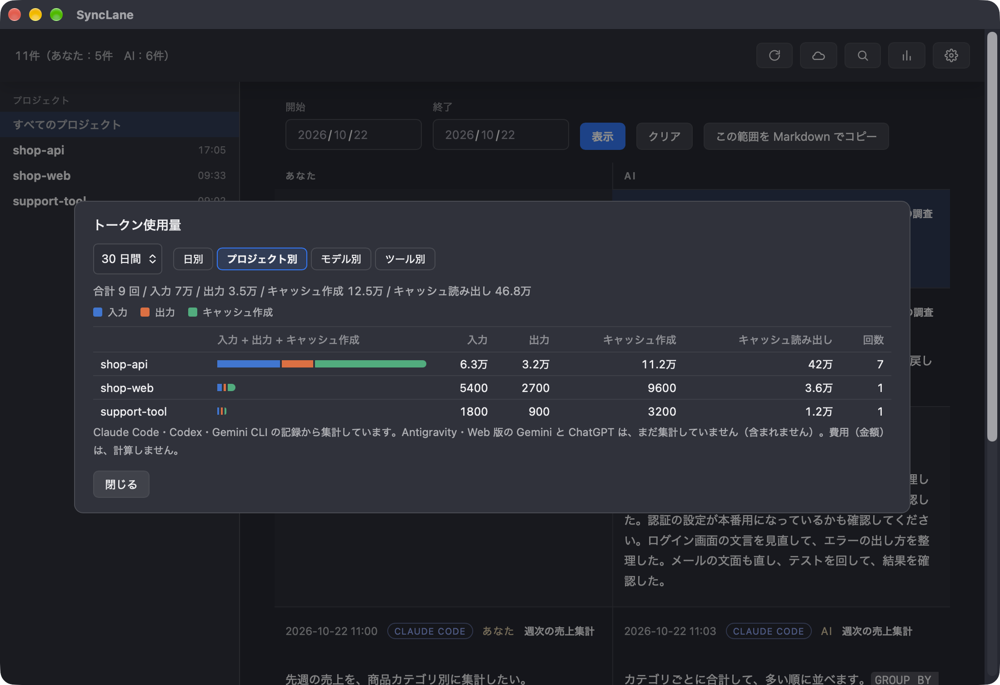
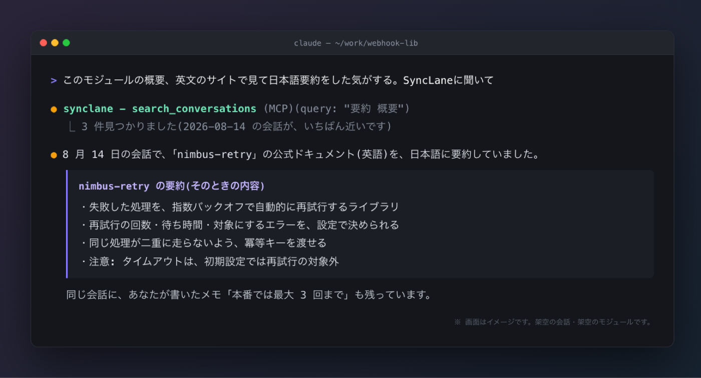

# SyncLane

日本語 | [English](README.en.md)

**AIとの会話を、ぜんぶ残して、あとで探せる。**

Claude Code・Codex・Gemini・ChatGPT との会話を、自分の Mac の中に1か所で保存する、無料のオープンソースアプリ(macOS)。キーワードや日付で探せるほか、AIに探させることもできます。



※画面は、作り話の会話です。

- **AIとの会話が、1か所に集まる**: Claude Code・Codex・Gemini CLI・Antigravity CLI は自動で集め、Web 版の Gemini・ChatGPT は Chrome 拡張で取り込みます。
- **AIに、自分の過去を聞ける**: MCPサーバーとして動くので、「前にこの問題、どう解決したっけ?」とAIに聞けます(読み取り専用)。
- **記録が、手元に残る**: 保存先は Mac の中の SQLite です。ツール側で履歴が見られなくなっても、残ります。**初期状態では、外のサーバーには何も送りません。**
- **プロジェクトで絞り込み、Markdown で書き出し、トークン使用量も見られる**: 詳しくは「画面でできること」。
- **日本語も探せる**: 全文検索で、日本語は部分一致で探せます。
- 無料・オープンソース(MIT)。署名・公証済みの dmg で入れられます([ダウンロード](https://mrktools.app/ja/synclane/download/))。

会社などが用意した SyncLane サーバーに自分で接続した場合だけ、選んだ会話を送ります(任意。下の「サーバーに送る」)。

## 取り込めるもの

| 取り込み元 | 方法 |
|---|---|
| Claude Code | アプリ起動中、30秒ごとに自動(`~/.claude/projects`) |
| Codex(Codex アプリ・Codex CLI) | アプリ起動中、30秒ごとに自動(`~/.codex/sessions`) |
| Gemini(ウェブ版)・ChatGPT(ウェブ版) | Chrome 拡張([手順](#geminichatgpt-の会話を取り込むchrome-拡張)) |
| Gemini CLI | アプリ起動中、30秒ごとに自動(`~/.gemini/tmp`) |
| Antigravity CLI(`agy`) | アプリ起動中、30秒ごとに自動(`~/.gemini/antigravity-cli`) |

コマンド(CLI)は、**配布版(dmg)には入っていません**。ソースをビルドして使います(下の「開発」)。過去の会話を日付で取り込み直すときなどに使います。配布版のアプリは、画面と、AI から検索するための MCP(`--mcp`)だけです。

保存するのは、あなたの入力と、AIのテキストの応答です。ツールの実行結果と、AIの思考の過程は保存しません。

## インストール

[mrktools.app/ja/synclane/download/](https://mrktools.app/ja/synclane/download/) から、dmg をダウンロードして、`SyncLane.app` を `/Applications` に入れます。署名・公証済みで、新しい版は、アプリが自動で知らせます。

アプリを起動しておくと、30秒ごとに、Claude Code の新しい会話(`~/.claude/projects`)と、Codex の新しい会話(`~/.codex/sessions`)、Gemini CLI の新しい会話(`~/.gemini/tmp`)、Antigravity CLI の新しい会話(`~/.gemini/antigravity-cli`)を取り込みます。

## Gemini・ChatGPT の会話を取り込む(Chrome 拡張)

Web 版の Gemini(gemini.google.com)と ChatGPT(chatgpt.com)の会話は、ローカルにファイルが無いので、Chrome 拡張で取り込みます。

1. [Chrome ウェブストアの「SyncLane for AI chats」](https://chromewebstore.google.com/detail/synclane-for-ai-chats/jibhikabeebhfbhablfedojafekcmmog?hl=ja)を開き、「Chrome に追加」を押します。
2. SyncLane を起動したまま、Gemini か ChatGPT で会話を開きます(拡張を入れる前から開いていたタブは、再読み込みしてください)。回答が書き終わると、自動で取り込まれます。

ストアを使わず、手で入れることもできます(開発者向け):

1. 拡張をダウンロードして、展開します。`~/Downloads/SyncLane-extension` フォルダができます(このフォルダは、消さないでください。消すと、拡張が動かなくなります)。

   ```
   https://mrktools.app/downloads/synclane/SyncLane-extension.zip
   ```

2. Chrome で `chrome://extensions` を開き、右上の「デベロッパー モード」をオンにします。
3. 「パッケージ化されていない拡張機能を読み込む」で、`~/Downloads/SyncLane-extension` を選びます。

- 送り先は、この Mac の SyncLane アプリ(`127.0.0.1`)だけです。外部のサーバーには送りません。アプリが起動していなければ、あとで送り直します。
- 取り込まれるのは、**Chrome で開いた会話**です。Gemini アプリ(Mac)やスマホだけで交わした会話は、同期されていても、Chrome で一度開くまで取り込まれません。
- 発言の時刻は、ChatGPT は画面にある時刻を使います。Gemini は画面に時刻が無いので、「取り込んだ時刻」になります。文章は、書式(見出し・表など)を外した文字だけです。
- ソースから使う場合は、このリポジトリの `extension/` フォルダを選びます。zip は、`sh scripts/pack-extension.sh` で作ります。
- 取り込まれないときは、まず、**拡張が有効になっているか**(`chrome://extensions` で、「SyncLane for AI chats」のスイッチがオンか)、SyncLane アプリが起動しているか、タブを再読み込みしたかを、確かめてください。拡張のアイコンに「×」が出ていれば、アプリに届いていません。
- 各サイトが画面の作りを変えると、取り込めなくなることがあります。会話の画面なのに何も読み取れないときは、拡張のアイコンに「!」が出ます(アプリが起動していないときは「×」)。直し方は [`extension/README.md`](extension/README.md) を見てください。

## 画面でできること

- **プロジェクトで絞り込む**: 左のサイドバーに、プロジェクトの一覧(名前・最終更新)が出ます。押すとそのプロジェクトだけに絞られ、日付・検索と重ねて使えます。もう一度押すと解除です。窓が狭い(900px 以下)ときは隠れます。
- **Markdown でコピーする**: 話題ひとまとまり、または、いま一覧に出している範囲(日付・プロジェクト・検索語)を、Markdown にしてコピーできます。先頭に、別の AI への依頼文(要約して／続きから作業して／別の視点で評価して)を付けられます。範囲のコピーは、新しい話題から最大 50 件までです。秘密に見えるものは、既定で伏せます。
- **トークン使用量を見る**: ヘッダーの「トークン使用量」で、期間(今日・7 日・30 日・すべて)を、日別・プロジェクト別・モデル別・ツール別に集計して見られます。**集計できるのは、Claude Code・Codex・Gemini CLI だけです。** Antigravity と、Web 版の Gemini・ChatGPT は含まれません。**費用(金額)は計算しません。** 保存するのは数だけで、会話の本文は増えません。



※画面は、作り話の会話です。

## 検索のしくみ

全文検索の索引つきで、日本語も、部分一致で探せます。索引で探せるのは3文字以上の語で、それより短い語は、本文を直接探します。索引のために、データベースが、おおよそ4割大きくなります。

## 会話の題名を編集する

一覧の題名の右にある ✎ から、題名を書き換えられます。Claude Code が付ける題名は、会話の最初に1度だけで、話題が変わっても更新されないためです。

- 題名は、**話題のまとまり(区切り)ごと**に付きます。長く続いた1つの会話でも、片方の話題の題名を変えて、もう片方に影響しません。区切りは、前の発言から **30 分以上** あいた位置と、「続きから」再開された位置(Claude Code が、長くなった会話を要約して続けたところ)で、自動で決まります。空にして保存すると、その区切りの題名を外して、会話全体の題名に戻ります。
- 編集した題名は、あとから取り込みで上書きされません。
- 「最近の発言から提案」: 最近の発言から、手元の規則で、題名の候補を出します。外には何も送りません。
- サーバーに送る題名は、いまのところ、会話全体の題名です(区切りの題名は、手元だけで使います)。

## サーバーに送る(任意)

会社などが用意した SyncLane サーバーに接続すると、選んだ会話を、そのサーバーへ HTTPS で送れます。チームで過去の経緯を探せるようになります。サーバーは別に提供されるもので、このリポジトリには含まれません。**いまは、提供していません。**

- **接続しなければ、何も送りません。** 接続しても、**既定では何も送りません。** 送る会話を自分で選ぶか、自動のモードにします。
- 接続は、ブラウザで承認する方式です(アプリにパスワードを入力しません)。端末のトークンは、macOS のキーチェーンに保存します。
- 送るのは、会話の本文(あなたの発言と AI の応答)、題名、プロジェクトのパス、時刻です。送らない会話は、いつでも除外できます。
- **秘密に見えるものは、伏せて送ります。** API キー・トークン・秘密鍵・URL の中のパスワード・`password=…` や `…_key=…` のような代入を、`[MASKED:種類]` に置き換えます。伏せるのは送る分だけで、手元の記録と検索は元のままです。迷ったら伏せる側に倒しているので、秘密でないものを伏せることもあります。
- **設定の「秘密の伏せ方」で、2 つのリストを編集できます**(保存先は、データベースの隣のファイル。直接編集もできます)。
- 伏せなくてよい値は、1 行に 1 つ書くと、そのまま送ります(`mask-allow.txt`。`#` で始まる行はコメント)。値が**完全に一致**したときだけ通ります。書いた値は、そのまま外に出ます。
- 社内だけの名前(ホスト名・顧客名・案件のコード名など)は、既定のルールでは分かりません。必ず伏せたい語は、1 行に 1 つ書きます(`mask-block.txt`)。普通の行はその文字列そのもの(大文字小文字を区別)、`名前=` や `名前:` のように `=` か `:` で終わる行は続く値も伏せる、`re:` で始まる行は正規表現です。読めない正規表現の行は無視します。`mask-allow.txt` と同じ値があるときは、こちらが優先です。
- 手元の SQLite が正本のままです。送れなくても、取り込みと手元の検索は止まりません。接続を解除すると、トークンを消します(サーバーに送り済みの会話は、サーバーに残ります)。

```sh
synclane server connect https://sync.example.com   # ブラウザで承認する
synclane sync list                                 # 会話と、送るかどうかの一覧
synclane sync include 12 14 --visibility org       # 会話を選んで送る(org は、サーバーの全員に見える)
synclane sync exclude 13                           # この会話は送らない
synclane sync mode auto                            # 除外した会話以外の全部を送る
synclane sync                                      # 送る(アプリは自動で送ります)
synclane server disconnect
```

## AIに聞く(MCP)

Claude Code に登録します。

```sh
claude mcp add --scope user synclane -- /Applications/SyncLane.app/Contents/MacOS/synclane-app --mcp
```

Claude アプリ(デスクトップ)には、`claude_desktop_config.json` に次を足します(設定画面の「MCP」タブでもコピーできます)。

```json
{ "mcpServers": { "synclane": { "command": "/Applications/SyncLane.app/Contents/MacOS/synclane-app", "args": ["--mcp"] } } }
```

登録すると、AIに「SyncLane に聞いて」と頼むだけで、保存した会話から探して答えます。

AI が使えるツールは、次の4つです(すべて読み取り専用)。

| ツール | できること |
|---|---|
| `search_conversations` | キーワードで会話を探す。`project` を付けると、そのプロジェクトの会話だけに絞る |
| `get_session` | 見つけた会話の、前後を読む |
| `list_projects` | プロジェクトの一覧(名前・場所・会話の数・使っているツール・最終更新) |
| `get_project_context` | プロジェクトの最近の状況(直近の会話の題名と、最後のやりとり) |



登録すると、そのAIは、保存した会話をすべて読めます。パスワードや機密のコードが入っていないか、先に確認してください。

## 開発

### Tauri画面

保存済みのイベントを日付ごとのタイムラインで確認できる最小画面を用意している。

```sh
cargo run --manifest-path src-tauri/Cargo.toml --offline
```

画面のデータは既定のSQLite（`~/Library/Application Support/SyncLane/synclane.db`）から読み込む。

### Windows でビルドする(試験的・未検証)

**作者は、Windows で動かして確かめていません。** 配布版(インストーラー)は macOS 用だけです。保存先やブラウザを開く処理など、Windows 向けの分岐はコードに入っていますが、ビルドが通るか、画面が動くかは、確認していません。試す場合は、うまくいかなかった点を、[Issues](https://github.com/MR-TABATA/SyncLane/issues) で教えてください。

必要なもの: [Rust](https://rustup.rs)(MSVC 版)、Visual Studio Build Tools(「C++ によるデスクトップ開発」)、Git。画面(Tauri)には、WebView2 も必要です(Windows 11 には、はじめから入っています)。

```powershell
git clone https://github.com/MR-TABATA/SyncLane.git
cd SyncLane

# コマンド(画面なし)
cargo build --release
.\target\release\synclane.exe --help

# 画面
cargo run --manifest-path src-tauri/Cargo.toml
```

保存先は `%LOCALAPPDATA%\SyncLane\synclane.db` です。取り込み元は、`%USERPROFILE%\.claude\projects`(Claude Code)、`%USERPROFILE%\.codex\sessions`(Codex)、`%USERPROFILE%\.gemini\tmp`(Gemini CLI)です。

### テスト

```sh
cargo test --offline
```

ネットワークに接続できる環境では、通常の `cargo test` も使用できる。

### CLI

データベースの既定の保存先は次のとおり。

```text
~/Library/Application Support/SyncLane/synclane.db
```

開発中は `--db` で保存先を変更できる。

```sh
cargo run -- init
cargo run -- status
cargo run -- --db /tmp/synclane.db init
cargo run -- --db /tmp/synclane.db status
cargo run -- --db /tmp/synclane.db timeline --limit 20
cargo run -- --db /tmp/synclane.db timeline --date 2026-10-13 --limit 20
cargo run -- import claude --date 2026-10-13
cargo run -- --db /tmp/synclane.db import claude --root ~/.claude/projects --date 2026-10-13
```

`SYNCLANE_DB` 環境変数でも保存先を指定できる。

```sh
SYNCLANE_DB=/tmp/synclane.db cargo run -- status
```

### Claude Codeログの取り込み

`import claude` は `~/.claude/projects/**/*.jsonl` を読み、ユーザー入力とAIのテキスト応答を `sessions` / `events` に追記する。ツール実行結果やthinkingブロックは、現段階では保存しない。

```sh
cargo run -- import claude --date YYYY-MM-DD
cargo run -- import claude --all
```

### Gemini CLIログの取り込み

アプリは、`~/.gemini/tmp/**/*.jsonl` を、30秒ごとに読みます(大きさが変わったファイルだけ、読み直します)。Gemini CLI は、同じ会話を何度も別のファイルに書き出す(実際の記録で、会話 6 つに対して、ファイルが 2 万個あった)ので、同じ会話の複写は、いちばん新しい 1 つだけを読み、同じ発言の途中経過は、最後の版を採ります。コマンドの `import gemini` も、同じ記録を読み、ユーザー入力とGeminiのテキスト応答を追記する。Gemini CLIの更新ログは同じメッセージ配列を繰り返すことがあるため、メッセージIDで重複を除外する。

```sh
cargo run -- import gemini --date YYYY-MM-DD
cargo run -- import gemini --all
```

`--date` を省略しても全イベントが対象になるが、明示的に取り込む場合は `--all` を使う。`--date` と `--all` は同時に指定できない。取り込みは冪等で、同じログを再実行してもイベントは重複しない。

### Antigravity CLIログの取り込み

アプリは、`~/.gemini/antigravity-cli/conversations/*.db`(会話ごとに SQLite が 1 つ)を、30秒ごとに読みます。書き換わった会話だけを読み直し、読み取り専用で開くので、Antigravity の記録は書き換えません。保存するのは、あなたの発言と AI の回答だけです。ツールの実行・考え中の表示は保存しません。プロジェクトは、まだ取れないので、一律「Antigravity」と表示します。コマンドの `import` はありません(アプリの自動取り込みだけです)。

- **IDE 版の Antigravity(`~/.gemini/antigravity/conversations/*.pb`)は、取り込めません。** 記録が暗号化されているらしく、読めないためです。CLI 版(`agy`)の会話が対象です。
- 記録の形式は公開されていないので、実際の記録の構造から読み方を決めています。Antigravity の更新で形式が変わると、取り込めなくなることがあります。

### Codexログの取り込み

`import codex` は `~/.codex/sessions/**/rollout-*.jsonl`(ChatGPT の Codex アプリと Codex CLI のログ)を読み、ユーザーの発言(`UserMessage`)と Codex の回答(`AgentMessage`)を追記する。考え中の表示・コマンドの実行・ファイルの変更などは保存しない。プロジェクトは、ログの作業フォルダ(`cwd`)から付け、題名は最初の発言から付ける。

```sh
cargo run -- import codex --date YYYY-MM-DD
cargo run -- import codex --all
```

- Codex のログは数百MBになる。アプリは、読み終えた位置を覚えて、追記された分だけを読む。
- 会話を分岐・複製すると、元の履歴が新しいファイルにコピーされる。同じ発言は1件だけ保存し、元のセッションに残す(複製側には、その後の発言が入る)。
- ChatGPT の Web 版には、アプリの「このコンピューター」で動かした作業は出ない。Codex のログ(このフォルダ)から取り込む。

### タイムラインの確認

`timeline` は保存済みイベントを新しい順に表示する。Tauri画面の表示モデルを固めるための初期版。

```sh
cargo run -- --db /tmp/synclane.db timeline --date YYYY-MM-DD --limit 20
```

### 現在のスキーマ

SQLiteの設計は [docs/sqlite-schema.md](docs/sqlite-schema.md) を参照。

主なテーブルは次のとおり。

- `sessions`: AIツールのセッション
- `events`: ユーザー入力・AI応答・ツール実行などの原イベント
- `journals`: AIが生成した日記
- `analyses`: 期間ごとの傾向分析
- `tags` / `event_tags`: タグ
- `settings`: アプリ設定

イベントは追記型で、`source_tool` と `source_event_id` の組み合わせで重複登録を防ぐ。


## ライセンス

MIT([LICENSE](LICENSE))
